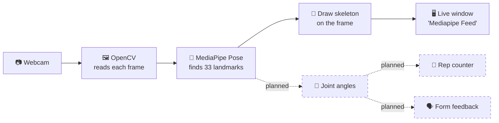
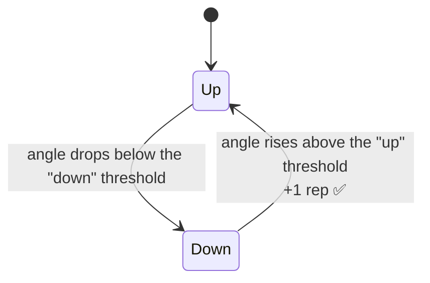

<div align="center">

# 💪 IntelliFit

### An AI-Powered Fitness Companion

Real-time pose estimation that watches your form, so every rep counts.

[](https://www.python.org/)
[](https://developers.google.com/mediapipe)
[](https://opencv.org/)
[](https://numpy.org/)
[](https://jupyter.org/)

**👇 Jump to a section**

[🎯 About](#-about) •
[✨ Features](#-features) •
[🧠 How It Works](#-how-it-works) •
[🚀 Get Started](#-get-started) •
[📸 Demo](#-demo) •
[🩺 Troubleshooting](#-troubleshooting) •
[🧭 Roadmap](#-roadmap)

</div>

---

## 🎯 About

IntelliFit's AI-driven performance evaluation and correction system provides professional-grade workout assistance by leveraging deep learning, pose estimation and motion analysis. Using real-time video input from a camera, it employs frameworks like **MediaPipe** and **OpenCV** to detect key skeletal landmarks, analyzing them against an extensive database of ideal exercise forms. This allows IntelliFit to identify deviations in posture, joint angles or balance and deliver instant corrective feedback through visual, auditory or haptic alerts.

Beyond form correction, IntelliFit tracks performance metrics such as range of motion, speed and consistency, offering personalized recommendations based on fitness levels and goals. By ensuring proper execution, minimizing injury risks and adapting to user progress, IntelliFit transforms workouts into safe, efficient and results-driven experiences with real-time, AI-powered precision.

> 🚧 **Project status:** the current notebook is the **foundation**. It captures your webcam feed and detects your body pose live. Joint-angle analysis and rep counting are the next steps, see the [roadmap](#-roadmap).

---

## ✨ Features

<details open>
<summary><b>▶ ✅ Available now</b></summary>

<br>

- 🎥 **Real-time webcam capture** using OpenCV
- 🦴 **Pose detection** of 33 body landmarks with MediaPipe
- 🖍️ **Live skeleton overlay** drawn on your video feed
- 📊 **Landmark data access**: read the x, y, z and visibility values for each joint
- ⌨️ **Simple controls**: press **Q** to quit

</details>

<details>
<summary><b>▶ 🚧 In progress / planned</b></summary>

<br>

- 📐 **Joint angle analysis** (elbows, knees, hips and more)
- 🔢 **Repetition counting** logic
- 🗣️ **Instant corrective feedback** through visual and audio alerts
- 📈 **Performance metrics**: range of motion, speed and consistency
- 🎯 **Personalized recommendations** based on fitness level and goals

</details>

---

## 🧠 How It Works

<details open>
<summary><b>▶ The pipeline</b></summary>

<br>



Solid lines are working today. Dashed lines are planned features.

</details>

<details>
<summary><b>▶ How rep counting will work (planned)</b></summary>

<br>

The idea is simple: measure a joint angle on every frame and count a rep each time the movement completes a full cycle.



Thresholds will differ per exercise, for example elbow angle for curls and knee angle for squats.

</details>

<details>
<summary><b>▶ Current detection settings</b></summary>

<br>

| Setting | Value |
|---------|:-----:|
| Minimum detection confidence | `0.5` |
| Minimum tracking confidence | `0.5` |
| Quit key | `Q` |

</details>

---

## 🚀 Get Started

<details open>
<summary><b>▶ Set up and run in 5 steps</b></summary>

<br>

**Requirements:** Python 3.9+, a working webcam and Jupyter Notebook.

**1. Clone the project**

```bash
git clone https://github.com/adeebmansoor/IntelliFit.git
cd IntelliFit
```

**2. Create a virtual environment** *(recommended)*

```bash
python -m venv venv
```

Activate it:

| System | Command |
|--------|---------|
| 🪟 Windows | `venv\Scripts\activate` |
| 🍎 macOS / 🐧 Linux | `source venv/bin/activate` |

**3. Install dependencies**

```bash
pip install mediapipe opencv-python numpy matplotlib notebook
```

**4. Launch the notebook**

```bash
jupyter notebook "ai pose and reps tracker.ipynb"
```

**5. Use the tracker**

1. Make sure your webcam is connected and not used by another app
2. Run the notebook cells **in order**
3. A window opens showing your live feed with pose landmarks
4. Press **`Q`** to close the window

</details>

<details>
<summary><b>▶ 📦 Dependencies</b></summary>

<br>

| Package | Purpose |
|---------|---------|
| `mediapipe` | Pose estimation |
| `opencv-python` | Webcam capture and drawing |
| `numpy` | Math and array handling |
| `matplotlib` | Plotting |
| `notebook` | Running the Jupyter notebook |

MediaPipe also installs a few helper packages automatically, such as `protobuf` and `jax`.

</details>

<details>
<summary><b>▶ 🔧 Configuration</b></summary>

<br>

No special configuration needed. Just make sure:

- [x] Your webcam is connected and accessible
- [x] Python 3.9+ is installed
- [x] All dependencies are installed

</details>

---

## 📸 Demo

<div align="center">


*Live pose landmarks drawn over the webcam feed*

</div>

> 💡 Want to add your own? Take a screenshot while the webcam feed is running, drag it into the README editor on GitHub, and it will upload automatically.

---

## 🩺 Troubleshooting

<details>
<summary><b>▶ <code>ModuleNotFoundError: No module named 'cv2'</code></b></summary>

<br>

The notebook is running in a different Python environment from the one where you installed the packages. Install inside the notebook itself, in the first cell:

```python
%pip install mediapipe opencv-python numpy matplotlib
```

Then restart the kernel and run the cells again.

</details>

<details>
<summary><b>▶ The webcam window is black or doesn't open</b></summary>

<br>

- Close other apps that may be using the camera, such as Zoom, Teams or your browser
- Allow camera access for your terminal or Python in your system privacy settings
- If you have more than one camera, try changing the camera index in `cv2.VideoCapture(0)` to `1` or `2`

</details>

<details>
<summary><b>▶ The window won't close</b></summary>

<br>

Click on the video window first so it has focus, then press **`Q`**. If it still hangs, restart the notebook kernel.

</details>

<details>
<summary><b>▶ Pose detection is jumpy or inaccurate</b></summary>

<br>

- Make sure your **whole body** is in the frame with good lighting
- Stand a few steps back from the camera
- Wear clothes that contrast with the background

</details>

---

## 🧭 Roadmap

- [x] Real-time webcam capture
- [x] Pose landmark detection and drawing
- [ ] Joint angle calculation helper
- [ ] Rep counting for common exercises (curls, squats, push-ups)
- [ ] Posture and form correction feedback
- [ ] Audio alerts for form mistakes
- [ ] Workout metrics: range of motion, speed and consistency
- [ ] Personalized recommendations
- [ ] Web or mobile app version

---

## 📁 Project Structure

```text
IntelliFit/
├── ai pose and reps tracker.ipynb   # Main notebook
└── README.md                        # You are here
```

---

## 🤝 Author

**Adeeb Mansoor**

[](https://github.com/adeebmansoor/)

---

<div align="center">

⭐ If IntelliFit inspires you, give it a star!

*Train smarter. Move better.* 💪

</div>
